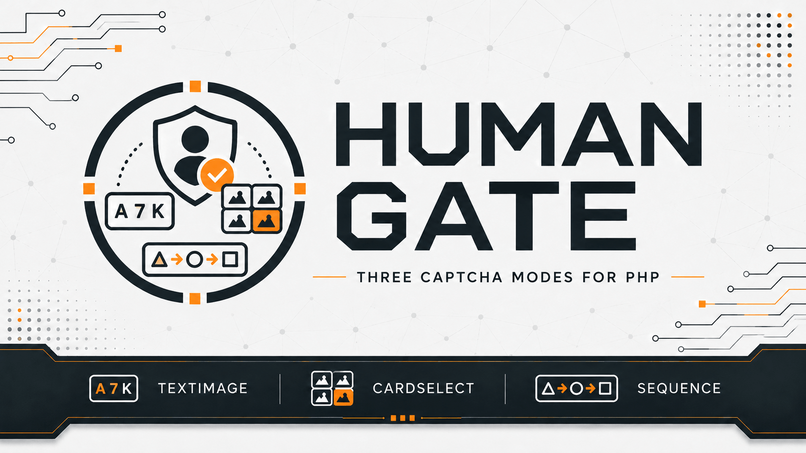

# Human Gate

[](https://github.com/yaleksandr89/human-gate)
[](https://github.com/yaleksandr89/human-gate/actions/workflows/ci.yml)
[](https://packagist.org/packages/yaleksandr89/human-gate)
[](https://packagist.org/packages/yaleksandr89/human-gate)
[](https://www.php.net/)
[](../../LICENSE)



## Sprache auswählen

| Русский | English | Español | 中文 | Français | Deutsch |
|---|---|---|---|---|---|
| [Русский](../../README.md) | [English](README_en.md) | [Español](README_es.md) | [中文](README_zh.md) | [Français](README_fr.md) | **Ausgewählt** |

Ein Composer-Paket zum Erstellen von CAPTCHAs und Prüfen von Antworten in PHP-Anwendungen. Geeignet für Registrierungs-, Kontakt- und Kommentarformulare, um automatisierte Einsendungen zu reduzieren.

CAPTCHAs werden auf dem Server ohne externe Dienste erzeugt und geprüft. Das Paket funktioniert mit oder ohne PHP-Framework.

## Wofür das Paket gedacht ist

Vor der Verarbeitung eines Formulars zeigt die Anwendung ein CAPTCHA an. Der Benutzer sendet seine Antwort, Human Gate prüft sie serverseitig, und bei einer richtigen Antwort kann die Anwendung fortfahren. Ein bestandenes CAPTCHA lässt sich nicht wiederverwenden.

## Funktionen

- Drei CAPTCHA-Arten:
  - [**Text-CAPTCHA (`TextImage`)**](../challenges/text-image_de.md): Zeichen aus einem Bild eingeben.
  - [**Kartenauswahl nach Kategorie (`CategorySelection`)**](../challenges/category-selection_de.md): Karten einer Kategorie auswählen.
  - [**Symbolfolge (`IconSequence`)**](../challenges/icon-sequence_de.md): die Reihenfolge von Symbolen aus einem Bild wiederholen.
- Konfigurierbare Gültigkeitsdauer, Anzahl falscher Antworten und Anzahl gleichzeitig aktiver CAPTCHAs.
- CAPTCHA-Erneuerung und Schutz vor der Wiederverwendung einer richtigen Antwort.
- Sofort nutzbare [Speicherung in standardmäßigen PHP-Sessions](../guides/integration_de.md).
- In PHP umgesetzt, ohne zusätzliche Composer-Laufzeitabhängigkeiten oder externe Prüfdienste. Die Anwendung legt Aussehen und technische Umsetzung der Benutzeroberfläche selbst fest.

## Voraussetzungen

- `PHP ^8.4`.
- Erweiterung `ext-gd` mit FreeType-Unterstützung.
- Composer.

## Installation

```bash
composer require yaleksandr89/human-gate
```

## Schnellstart

Die drei folgenden Beispiele erstellen ein CAPTCHA mit einer PHP-Session. Jedes öffnet die Session mit `session_start()` und speichert dort die Prüfdaten. Über `ChallengeStore` lässt sich eine andere Speicherung anbinden, wie in der [Integrationsanleitung](../guides/integration_de.md) beschrieben.

Screenshots von [alexanderyurchenko.ru](https://alexanderyurchenko.ru/) zeigen eine mögliche Gestaltung. Das Paket erzeugt und prüft CAPTCHAs; die Anwendung implementiert das Frontend.

### Text-CAPTCHA (`TextImage`)

Der Benutzer gibt sechs Zeichen aus einem Bild ein. Groß- und Kleinschreibung wird standardmäßig nicht unterschieden.

<details>
<summary>PHP-Beispiel für ein Text-CAPTCHA anzeigen</summary>

```php
<?php

declare(strict_types=1);

use Yaleksandr\HumanGate\Challenge\Policy;
use Yaleksandr\HumanGate\Challenge\Purpose;
use Yaleksandr\HumanGate\ChallengeService;
use Yaleksandr\HumanGate\Clock\SystemClock;
use Yaleksandr\HumanGate\Session\ActiveNativeSessionScope;
use Yaleksandr\HumanGate\Session\NativeSessionChallengeStore;
use Yaleksandr\HumanGate\TextImage\GdTextImageRenderer;
use Yaleksandr\HumanGate\TextImage\TextImageStrategy;

require 'vendor/autoload.php';

if (!session_start()) {
    throw new RuntimeException('Не удалось открыть сессию PHP.');
}

$service = new ChallengeService(
    new NativeSessionChallengeStore(ActiveNativeSessionScope::capture()),
    new Policy(),
    new SystemClock(),
    new TextImageStrategy(new GdTextImageRenderer()),
);

$result = $service->issue(new Purpose('contact.send'));
if ($result->challenge === null) {
    throw new RuntimeException('Не удалось создать капчу.');
}

$id = $result->challenge->id->value();
$presentation = $result->challenge->presentation;
```

</details>

#### Text-CAPTCHA-Beispiel auf der Website


<details>
<summary>Weitere Ansichten: dunkles Design und Mobilgeräte</summary>

Dunkles Design auf dem Desktop:


Helles Design auf dem Smartphone:


Dunkles Design auf dem Smartphone:


</details>

Anpassbar sind Groß-/Kleinschreibung, Bildskalierung, Unschärfe, Rauschen und Zeichendrehung. Die Antwort umfasst stets sechs Zeichen. Siehe [Text-CAPTCHA-Einstellungen](../challenges/text-image_de.md).

### Kartenauswahl nach Kategorie (`CategorySelection`)

Der Benutzer wählt alle Karten der gefragten Kategorie. Kategorien und Beschriftungen liefert die Anwendung; die Auswahlreihenfolge ist egal.

<details>
<summary>PHP-Beispiel für die Kartenauswahl anzeigen</summary>

```php
<?php

declare(strict_types=1);

use Yaleksandr\HumanGate\CategorySelection\CategorySelectionCategory;
use Yaleksandr\HumanGate\CategorySelection\CategorySelectionStrategy;
use Yaleksandr\HumanGate\Challenge\ChallengeKind;
use Yaleksandr\HumanGate\Challenge\Policy;
use Yaleksandr\HumanGate\Challenge\Purpose;
use Yaleksandr\HumanGate\ChallengeService;
use Yaleksandr\HumanGate\Clock\SystemClock;
use Yaleksandr\HumanGate\Session\ActiveNativeSessionScope;
use Yaleksandr\HumanGate\Session\NativeSessionChallengeStore;

require 'vendor/autoload.php';

if (!session_start()) {
    throw new RuntimeException('Не удалось открыть сессию PHP.');
}

$service = new ChallengeService(
    new NativeSessionChallengeStore(ActiveNativeSessionScope::capture()),
    new Policy(),
    new SystemClock(),
    new CategorySelectionStrategy([
        new CategorySelectionCategory('Фрукты', ['Яблоко', 'Груша', 'Слива', 'Персик']),
        new CategorySelectionCategory('Инструменты', ['Молоток', 'Пила', 'Отвёртка', 'Клещи']),
    ]),
);

$result = $service->issue(new Purpose('contact.send'), ChallengeKind::CategorySelection);
if ($result->challenge === null) {
    throw new RuntimeException('Не удалось создать капчу.');
}

$id = $result->challenge->id->value();
$presentation = $result->challenge->presentation;
```

</details>

#### Beispiel der Kartenauswahl auf der Website


<details>
<summary>Weitere Ansichten: dunkles Design und Mobilgeräte</summary>

Dunkles Design auf dem Desktop:


Helles Design auf dem Smartphone:


Dunkles Design auf dem Smartphone:


</details>

Die Anzahl der Karten und der richtigen Auswahlen ist einstellbar; den Kategorienkatalog liefert die Anwendung. Siehe [Kartenauswahl-Einstellungen](../challenges/category-selection_de.md).

### Symbolfolge (`IconSequence`)

Der Benutzer wählt Symbole in derselben Reihenfolge wie im Bild. Die Reihenfolge ist entscheidend.

<details>
<summary>PHP-Beispiel für eine Symbolfolge anzeigen</summary>

```php
<?php

declare(strict_types=1);

use Yaleksandr\HumanGate\Challenge\ChallengeKind;
use Yaleksandr\HumanGate\Challenge\Policy;
use Yaleksandr\HumanGate\Challenge\Purpose;
use Yaleksandr\HumanGate\ChallengeService;
use Yaleksandr\HumanGate\Clock\SystemClock;
use Yaleksandr\HumanGate\IconSequence\IconSequenceStrategy;
use Yaleksandr\HumanGate\Session\ActiveNativeSessionScope;
use Yaleksandr\HumanGate\Session\NativeSessionChallengeStore;

require 'vendor/autoload.php';

if (!session_start()) {
    throw new RuntimeException('Не удалось открыть сессию PHP.');
}

$service = new ChallengeService(
    new NativeSessionChallengeStore(ActiveNativeSessionScope::capture()),
    new Policy(),
    new SystemClock(),
    new IconSequenceStrategy(),
);

$result = $service->issue(new Purpose('contact.send'), ChallengeKind::IconSequence);
if ($result->challenge === null) {
    throw new RuntimeException('Не удалось создать капчу.');
}

$id = $result->challenge->id->value();
$presentation = $result->challenge->presentation;
```

</details>

#### Beispiel der Symbolfolge auf der Website


<details>
<summary>Weitere Ansichten: dunkles Design und Mobilgeräte</summary>

Dunkles Design auf dem Desktop:


Helles Design auf dem Smartphone:


Dunkles Design auf dem Smartphone:


</details>

Anpassbar sind Folgenlänge, Anzahl der Auswahlmöglichkeiten, Symbolgröße, Unschärfe, Rauschen und Drehung. Siehe [Symbolfolge-Einstellungen](../challenges/icon-sequence_de.md).

Alle CAPTCHA-Arten teilen sich die [Einstellungen für Gültigkeit und Versuche](../reference/api_de.md#policy). Standardmäßig gilt ein CAPTCHA 180 Sekunden; `Policy::ttlSeconds` ändert diesen Wert.

Diese Beispiele zeigen die Erstellung eines CAPTCHAs. Die Anwendung verwendet die zurückgegebene ID und Bild- bzw. Kartendaten im Formular. Antwortübermittlung, [`ChallengeService::verify()`](../reference/api_de.md#verify) und Erneuerung sind in der [Integrationsanleitung](../guides/integration_de.md) beschrieben.

## CAPTCHA-Lebenszyklus

Ein CAPTCHA ist standardmäßig drei Minuten gültig. Die Zahl falscher Antworten wird separat begrenzt: Der dritte Fehler beendet die Prüfung auch bei verbleibender Zeit. Eine richtige Antwort wird nur einmal akzeptiert. Siehe [Gültigkeit, Versuche und Erneuerung](../reference/lifecycle_de.md).

## Serverseitige Prüfung

Human Gate speichert Prüfdaten auf dem Server und sendet die richtige Antwort nicht an den Browser. Jedes CAPTCHA ist über den Schlüssel [`Purpose`](../reference/api_de.md#grundlegende-typen) an ein bestimmtes Formular oder einen Vorgang gebunden: Ein CAPTCHA für eine Nachricht gilt nicht für die Registrierung. Weitere Informationen zur [Prüfung und Speicherung](../security-model_de.md).

## Rückmeldungen

- Reproduzierbare Fehler — [GitHub Issues](https://github.com/yaleksandr89/human-gate/issues).

---

<p align="center">
  Wenn dir dieses Paket geholfen hat, gib ihm einen Stern auf GitHub, damit andere Entwickler es leichter finden. 🤘
</p>
