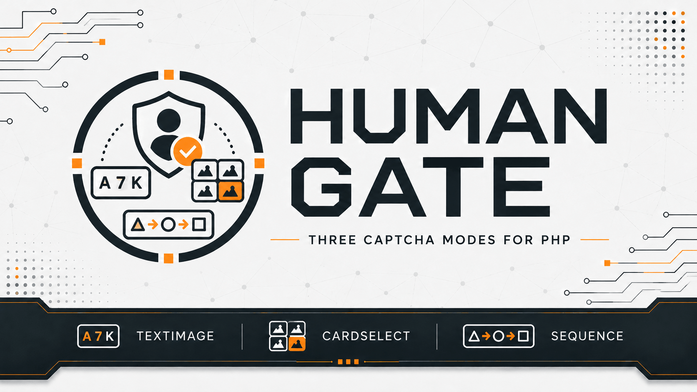

# Human Gate

[](https://github.com/yaleksandr89/human-gate)
[](https://github.com/yaleksandr89/human-gate/actions/workflows/ci.yml)
[](https://packagist.org/packages/yaleksandr89/human-gate)
[](https://packagist.org/packages/yaleksandr89/human-gate)
[](https://www.php.net/)
[](../../LICENSE)



## Choose a language

| Русский | English | Español | 中文 | Français | Deutsch |
|---|---|---|---|---|---|
| [Русский](../../README.md) | **Selected** | [Español](README_es.md) | [中文](README_zh.md) | [Français](README_fr.md) | [Deutsch](README_de.md) |

A Composer package for creating CAPTCHAs and checking answers in PHP applications. Useful for registration, contact, and comment forms where automated submissions need to be reduced.

CAPTCHAs are generated and verified on the server without calling an external service. The package works with or without a PHP framework.

## What the package is for

Before processing a form, the application displays a CAPTCHA. The user submits an answer, Human Gate checks it on the server, and the application can proceed if the answer is correct. A solved CAPTCHA cannot be reused.

## Features

- Three CAPTCHA types:
  - [**Text CAPTCHA (`TextImage`)**](../challenges/text-image_en.md): enter characters shown in an image.
  - [**Category card selection (`CategorySelection`)**](../challenges/category-selection_en.md): select cards belonging to a category.
  - [**Icon sequence (`IconSequence`)**](../challenges/icon-sequence_en.md): repeat the order of icons shown in an image.
- Configurable expiration time, wrong-answer limit, and number of active CAPTCHAs.
- CAPTCHA refresh and protection against reusing a correct answer.
- Ready-to-use [storage based on standard PHP sessions](../guides/integration_en.md).
- Implemented in PHP with no third-party Composer runtime dependencies or external verification services. The application controls the appearance and front-end implementation.

## Requirements

- `PHP ^8.4`.
- The `ext-gd` extension with FreeType support.
- Composer.

## Installation

```bash
composer require yaleksandr89/human-gate
```

## Quick start

The three examples below create a CAPTCHA using a PHP session. Each starts the session with `session_start()` and stores the verification data there. A different storage method can be provided through `ChallengeStore` as described in the [integration guide](../guides/integration_en.md).

Screenshots from [alexanderyurchenko.ru](https://alexanderyurchenko.ru/) illustrate one possible presentation. The package creates and verifies CAPTCHAs; the application implements the front end.

### Text CAPTCHA (`TextImage`)

The user enters six characters from an image. Letter case is ignored by default.

<details>
<summary>Show the PHP example for a text CAPTCHA</summary>

```php
<?php

declare(strict_types=1);

use Yaleksandr\HumanGate\Challenge\Policy;
use Yaleksandr\HumanGate\Challenge\Purpose;
use Yaleksandr\HumanGate\ChallengeService;
use Yaleksandr\HumanGate\Clock\SystemClock;
use Yaleksandr\HumanGate\Session\ActiveNativeSessionScope;
use Yaleksandr\HumanGate\Session\NativeSessionChallengeStore;
use Yaleksandr\HumanGate\TextImage\GdTextImageRenderer;
use Yaleksandr\HumanGate\TextImage\TextImageStrategy;

require 'vendor/autoload.php';

if (!session_start()) {
    throw new RuntimeException('Не удалось открыть сессию PHP.');
}

$service = new ChallengeService(
    new NativeSessionChallengeStore(ActiveNativeSessionScope::capture()),
    new Policy(),
    new SystemClock(),
    new TextImageStrategy(new GdTextImageRenderer()),
);

$result = $service->issue(new Purpose('contact.send'));
if ($result->challenge === null) {
    throw new RuntimeException('Не удалось создать капчу.');
}

$id = $result->challenge->id->value();
$presentation = $result->challenge->presentation;
```

</details>

#### Example text CAPTCHA on the website


<details>
<summary>Other views: dark theme and mobile screens</summary>

Dark theme on desktop:


Light theme on mobile:


Dark theme on mobile:


</details>

You can configure letter-case sensitivity, image scale, blur, noise, and character rotation. The answer always has six characters. See [text CAPTCHA options](../challenges/text-image_en.md).

### Category card selection (`CategorySelection`)

The user selects every card in the requested category. The application supplies the categories and labels; selection order does not matter.

<details>
<summary>Show the PHP example for category card selection</summary>

```php
<?php

declare(strict_types=1);

use Yaleksandr\HumanGate\CategorySelection\CategorySelectionCategory;
use Yaleksandr\HumanGate\CategorySelection\CategorySelectionStrategy;
use Yaleksandr\HumanGate\Challenge\ChallengeKind;
use Yaleksandr\HumanGate\Challenge\Policy;
use Yaleksandr\HumanGate\Challenge\Purpose;
use Yaleksandr\HumanGate\ChallengeService;
use Yaleksandr\HumanGate\Clock\SystemClock;
use Yaleksandr\HumanGate\Session\ActiveNativeSessionScope;
use Yaleksandr\HumanGate\Session\NativeSessionChallengeStore;

require 'vendor/autoload.php';

if (!session_start()) {
    throw new RuntimeException('Не удалось открыть сессию PHP.');
}

$service = new ChallengeService(
    new NativeSessionChallengeStore(ActiveNativeSessionScope::capture()),
    new Policy(),
    new SystemClock(),
    new CategorySelectionStrategy([
        new CategorySelectionCategory('Фрукты', ['Яблоко', 'Груша', 'Слива', 'Персик']),
        new CategorySelectionCategory('Инструменты', ['Молоток', 'Пила', 'Отвёртка', 'Клещи']),
    ]),
);

$result = $service->issue(new Purpose('contact.send'), ChallengeKind::CategorySelection);
if ($result->challenge === null) {
    throw new RuntimeException('Не удалось создать капчу.');
}

$id = $result->challenge->id->value();
$presentation = $result->challenge->presentation;
```

</details>

#### Example category selection CAPTCHA on the website


<details>
<summary>Other views: dark theme and mobile screens</summary>

Dark theme on desktop:


Light theme on mobile:


Dark theme on mobile:


</details>

You can configure the number of cards and correct selections; the application provides the category catalog. See [category selection options](../challenges/category-selection_en.md).

### Icon sequence (`IconSequence`)

The user selects icons in the same order as they appear in the image. Selection order matters.

<details>
<summary>Show the PHP example for an icon sequence</summary>

```php
<?php

declare(strict_types=1);

use Yaleksandr\HumanGate\Challenge\ChallengeKind;
use Yaleksandr\HumanGate\Challenge\Policy;
use Yaleksandr\HumanGate\Challenge\Purpose;
use Yaleksandr\HumanGate\ChallengeService;
use Yaleksandr\HumanGate\Clock\SystemClock;
use Yaleksandr\HumanGate\IconSequence\IconSequenceStrategy;
use Yaleksandr\HumanGate\Session\ActiveNativeSessionScope;
use Yaleksandr\HumanGate\Session\NativeSessionChallengeStore;

require 'vendor/autoload.php';

if (!session_start()) {
    throw new RuntimeException('Не удалось открыть сессию PHP.');
}

$service = new ChallengeService(
    new NativeSessionChallengeStore(ActiveNativeSessionScope::capture()),
    new Policy(),
    new SystemClock(),
    new IconSequenceStrategy(),
);

$result = $service->issue(new Purpose('contact.send'), ChallengeKind::IconSequence);
if ($result->challenge === null) {
    throw new RuntimeException('Не удалось создать капчу.');
}

$id = $result->challenge->id->value();
$presentation = $result->challenge->presentation;
```

</details>

#### Example icon sequence CAPTCHA on the website


<details>
<summary>Other views: dark theme and mobile screens</summary>

Dark theme on desktop:


Light theme on mobile:


Dark theme on mobile:


</details>

You can configure the sequence length, number of choices, icon sizes, blur, noise, and rotation. See [icon sequence options](../challenges/icon-sequence_en.md).

All CAPTCHA types share the [expiration and attempt settings](../reference/api_en.md#policy). A CAPTCHA expires after 180 seconds by default; set `Policy::ttlSeconds` to change this.

These examples show CAPTCHA creation. The application uses the returned identifier and image or card data in its form. Sending an answer, calling [`ChallengeService::verify()`](../reference/api_en.md#verify), and refreshing a CAPTCHA are covered in the [integration guide](../guides/integration_en.md).

## CAPTCHA lifecycle

By default, a CAPTCHA is valid for three minutes. The wrong-answer limit is separate: the third incorrect answer ends the verification even if time remains. A correct answer is accepted only once. See [expiration, attempts, and refresh](../reference/lifecycle_en.md).

## Server-side verification

Human Gate keeps verification data on the server and never sends the correct answer to the browser. Each CAPTCHA is bound to a specific form or operation by the [`Purpose`](../reference/api_en.md#core-types) key: for example, a CAPTCHA issued for sending a message cannot be used for registration. Read more about [verification and storage](../security-model_en.md).

## Feedback

- Reproducible bugs — [GitHub Issues](https://github.com/yaleksandr89/human-gate/issues).

---

<p align="center">
  If this package has been useful, consider starring it on GitHub so other developers can find it more easily. 🤘
</p>
