# Human Gate

[](https://github.com/yaleksandr89/human-gate)
[](https://github.com/yaleksandr89/human-gate/actions/workflows/ci.yml)
[](https://packagist.org/packages/yaleksandr89/human-gate)
[](https://packagist.org/packages/yaleksandr89/human-gate)
[](https://www.php.net/)
[](../../LICENSE)

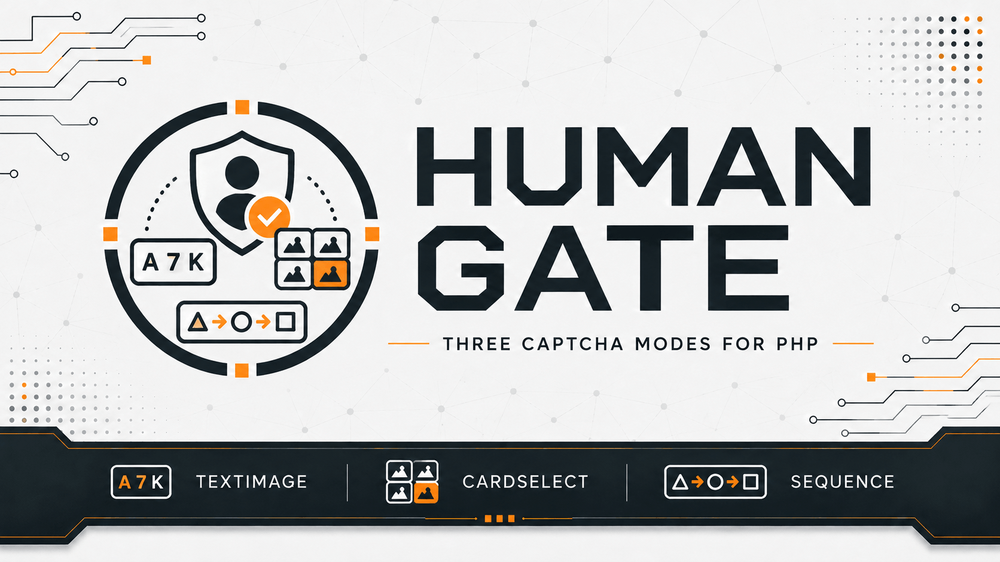

## Elige un idioma

| Русский | English | Español | 中文 | Français | Deutsch |
|---|---|---|---|---|---|
| [Русский](../../README.md) | [English](README_en.md) | **Seleccionado** | [中文](README_zh.md) | [Français](README_fr.md) | [Deutsch](README_de.md) |

Paquete de Composer para generar captchas y comprobar respuestas en aplicaciones PHP. Útil para formularios de registro, contacto y comentarios en los que se desea reducir los envíos automáticos.

Los captchas se generan y verifican en el servidor sin recurrir a servicios externos. El paquete funciona con cualquier framework PHP o sin uno.

## Para qué sirve el paquete

Antes de procesar un formulario, la aplicación muestra un captcha. El usuario envía su respuesta, Human Gate la comprueba en el servidor y, si es correcta, la aplicación puede continuar. Un captcha resuelto no se puede reutilizar.

## Características

- Tres tipos de captcha:
  - [**Captcha de texto (`TextImage`)**](../challenges/text-image_es.md): introducir los caracteres de una imagen.
  - [**Selección de tarjetas por categoría (`CategorySelection`)**](../challenges/category-selection_es.md): seleccionar tarjetas de una categoría.
  - [**Secuencia de iconos (`IconSequence`)**](../challenges/icon-sequence_es.md): repetir el orden de los iconos mostrados en una imagen.
- Tiempo de validez, número de respuestas incorrectas y cantidad de captchas activos configurables.
- Renovación del captcha y protección contra la reutilización de respuestas correctas.
- [Almacenamiento basado en sesiones PHP estándar](../guides/integration_es.md) listo para usar.
- Implementado en PHP sin dependencias adicionales de Composer en ejecución ni servicios externos de verificación. La aplicación decide cómo mostrar e implementar la interfaz.

## Requisitos

- `PHP ^8.4`.
- Extensión `ext-gd` con soporte de FreeType.
- Composer.

## Instalación

```bash
composer require yaleksandr89/human-gate
```

## Inicio rápido

Los tres ejemplos siguientes crean un captcha mediante una sesión PHP. Cada ejemplo abre la sesión con `session_start()` y guarda allí los datos de verificación. Es posible conectar otro almacenamiento mediante `ChallengeStore`, como se explica en la [guía de integración](../guides/integration_es.md).

Las capturas de [alexanderyurchenko.ru](https://alexanderyurchenko.ru/) muestran una posible presentación. El paquete crea y verifica captchas; la interfaz la implementa la aplicación.

### Captcha de texto (`TextImage`)

El usuario introduce seis caracteres de una imagen. De forma predeterminada no se distingue entre mayúsculas y minúsculas.

<details>
<summary>Mostrar el ejemplo PHP del captcha de texto</summary>

```php
<?php

declare(strict_types=1);

use Yaleksandr\HumanGate\Challenge\Policy;
use Yaleksandr\HumanGate\Challenge\Purpose;
use Yaleksandr\HumanGate\ChallengeService;
use Yaleksandr\HumanGate\Clock\SystemClock;
use Yaleksandr\HumanGate\Session\ActiveNativeSessionScope;
use Yaleksandr\HumanGate\Session\NativeSessionChallengeStore;
use Yaleksandr\HumanGate\TextImage\GdTextImageRenderer;
use Yaleksandr\HumanGate\TextImage\TextImageStrategy;

require 'vendor/autoload.php';

if (!session_start()) {
    throw new RuntimeException('Не удалось открыть сессию PHP.');
}

$service = new ChallengeService(
    new NativeSessionChallengeStore(ActiveNativeSessionScope::capture()),
    new Policy(),
    new SystemClock(),
    new TextImageStrategy(new GdTextImageRenderer()),
);

$result = $service->issue(new Purpose('contact.send'));
if ($result->challenge === null) {
    throw new RuntimeException('Не удалось создать капчу.');
}

$id = $result->challenge->id->value();
$presentation = $result->challenge->presentation;
```

</details>

#### Ejemplo del captcha de texto en el sitio web

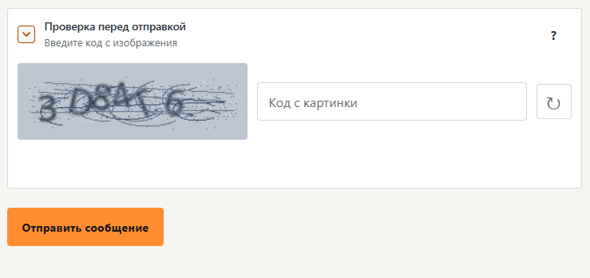

<details>
<summary>Otras vistas: tema oscuro y pantallas móviles</summary>

Tema oscuro en escritorio:

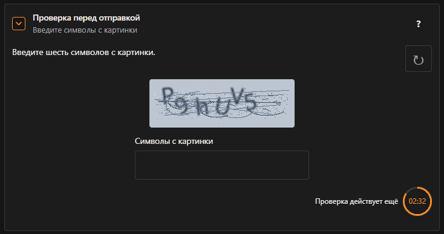

Tema claro en móvil:

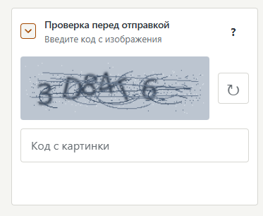

Tema oscuro en móvil:

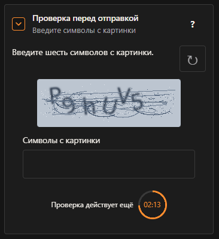

</details>

Se pueden configurar las mayúsculas y minúsculas, la escala de la imagen, el desenfoque, el ruido y la rotación. La respuesta siempre tiene seis caracteres. Consulta las [opciones del captcha de texto](../challenges/text-image_es.md).

### Selección de tarjetas por categoría (`CategorySelection`)

El usuario selecciona todas las tarjetas de la categoría indicada. La aplicación proporciona las categorías y etiquetas; el orden no importa.

<details>
<summary>Mostrar el ejemplo PHP de selección de tarjetas</summary>

```php
<?php

declare(strict_types=1);

use Yaleksandr\HumanGate\CategorySelection\CategorySelectionCategory;
use Yaleksandr\HumanGate\CategorySelection\CategorySelectionStrategy;
use Yaleksandr\HumanGate\Challenge\ChallengeKind;
use Yaleksandr\HumanGate\Challenge\Policy;
use Yaleksandr\HumanGate\Challenge\Purpose;
use Yaleksandr\HumanGate\ChallengeService;
use Yaleksandr\HumanGate\Clock\SystemClock;
use Yaleksandr\HumanGate\Session\ActiveNativeSessionScope;
use Yaleksandr\HumanGate\Session\NativeSessionChallengeStore;

require 'vendor/autoload.php';

if (!session_start()) {
    throw new RuntimeException('Не удалось открыть сессию PHP.');
}

$service = new ChallengeService(
    new NativeSessionChallengeStore(ActiveNativeSessionScope::capture()),
    new Policy(),
    new SystemClock(),
    new CategorySelectionStrategy([
        new CategorySelectionCategory('Фрукты', ['Яблоко', 'Груша', 'Слива', 'Персик']),
        new CategorySelectionCategory('Инструменты', ['Молоток', 'Пила', 'Отвёртка', 'Клещи']),
    ]),
);

$result = $service->issue(new Purpose('contact.send'), ChallengeKind::CategorySelection);
if ($result->challenge === null) {
    throw new RuntimeException('Не удалось создать капчу.');
}

$id = $result->challenge->id->value();
$presentation = $result->challenge->presentation;
```

</details>

#### Ejemplo de selección de tarjetas en el sitio web

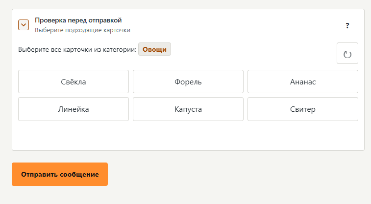

<details>
<summary>Otras vistas: tema oscuro y pantallas móviles</summary>

Tema oscuro en escritorio:

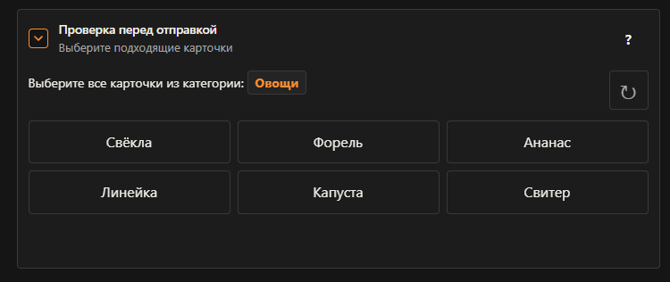

Tema claro en móvil:

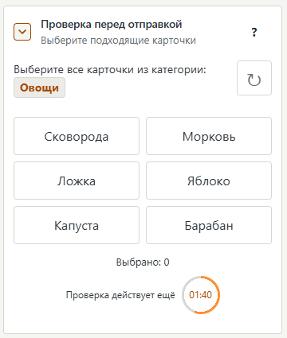

Tema oscuro en móvil:

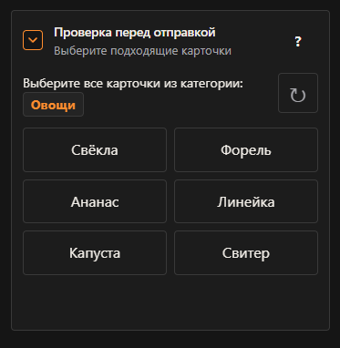

</details>

Se pueden configurar las cantidades de tarjetas y aciertos; la aplicación proporciona el catálogo de categorías. Consulta las [opciones de selección](../challenges/category-selection_es.md).

### Secuencia de iconos (`IconSequence`)

El usuario selecciona los iconos en el mismo orden que aparecen en la imagen. El orden sí importa.

<details>
<summary>Mostrar el ejemplo PHP de secuencia de iconos</summary>

```php
<?php

declare(strict_types=1);

use Yaleksandr\HumanGate\Challenge\ChallengeKind;
use Yaleksandr\HumanGate\Challenge\Policy;
use Yaleksandr\HumanGate\Challenge\Purpose;
use Yaleksandr\HumanGate\ChallengeService;
use Yaleksandr\HumanGate\Clock\SystemClock;
use Yaleksandr\HumanGate\IconSequence\IconSequenceStrategy;
use Yaleksandr\HumanGate\Session\ActiveNativeSessionScope;
use Yaleksandr\HumanGate\Session\NativeSessionChallengeStore;

require 'vendor/autoload.php';

if (!session_start()) {
    throw new RuntimeException('Не удалось открыть сессию PHP.');
}

$service = new ChallengeService(
    new NativeSessionChallengeStore(ActiveNativeSessionScope::capture()),
    new Policy(),
    new SystemClock(),
    new IconSequenceStrategy(),
);

$result = $service->issue(new Purpose('contact.send'), ChallengeKind::IconSequence);
if ($result->challenge === null) {
    throw new RuntimeException('Не удалось создать капчу.');
}

$id = $result->challenge->id->value();
$presentation = $result->challenge->presentation;
```

</details>

#### Ejemplo de secuencia de iconos en el sitio web

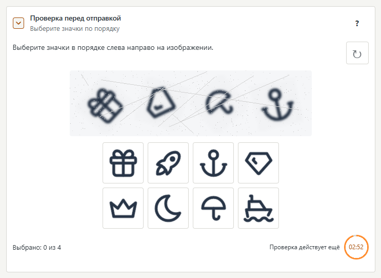

<details>
<summary>Otras vistas: tema oscuro y pantallas móviles</summary>

Tema oscuro en escritorio:

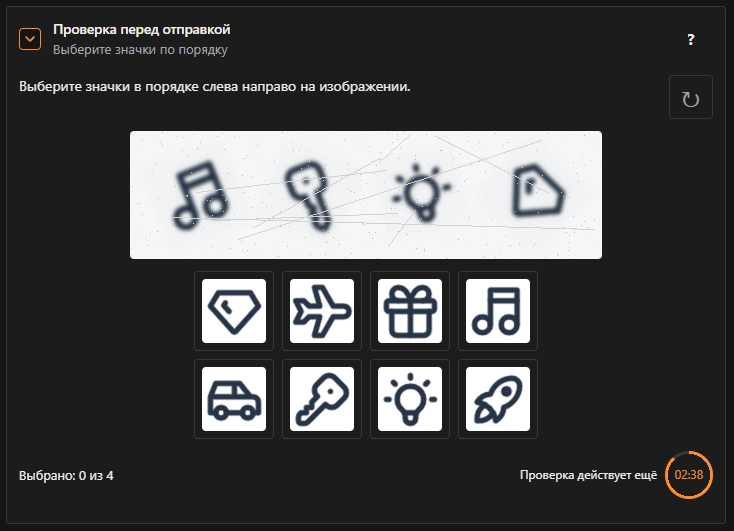

Tema claro en móvil:

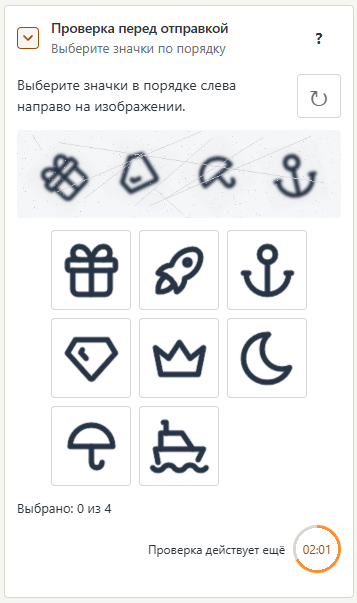

Tema oscuro en móvil:

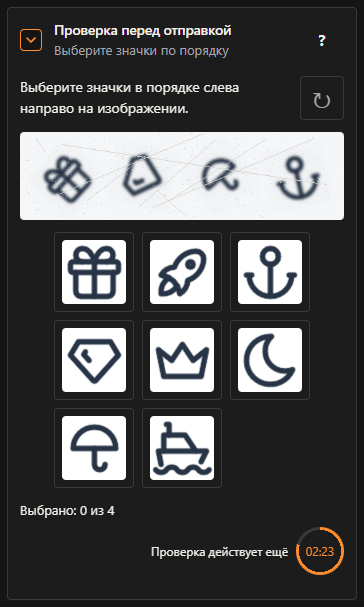

</details>

Se pueden configurar la longitud de la secuencia, la cantidad de opciones, el tamaño de los iconos, el desenfoque, el ruido y la rotación. Consulta las [opciones de secuencia](../challenges/icon-sequence_es.md).

Todos los captchas comparten la [configuración de validez e intentos](../reference/api_es.md#policy). Por defecto, el plazo es de 180 segundos; se cambia con `Policy::ttlSeconds`.

Estos ejemplos muestran cómo crear un captcha. La aplicación usa el identificador y los datos de imagen o tarjetas recibidos en su formulario. El envío de respuestas, [`ChallengeService::verify()`](../reference/api_es.md#verify) y la renovación se explican en la [guía de integración](../guides/integration_es.md).

## Ciclo de vida del captcha

Por defecto, un captcha dura tres minutos. El límite de respuestas incorrectas es independiente: el tercer error termina la comprobación aunque quede tiempo. Una respuesta correcta se acepta una sola vez. Consulta la [validez, los intentos y la renovación](../reference/lifecycle_es.md).

## Verificación en el servidor

Human Gate mantiene los datos de verificación en el servidor y no envía la respuesta correcta al navegador. Cada captcha está vinculado a un formulario u operación mediante la clave [`Purpose`](../reference/api_es.md#tipos-principales): un captcha para enviar un mensaje no sirve para registrarse. Más información sobre [verificación y almacenamiento](../security-model_es.md).

## Comentarios y errores

- Errores reproducibles — [GitHub Issues](https://github.com/yaleksandr89/human-gate/issues).

---

<p align="center">
  Si este paquete te ha resultado útil, dale una estrella en GitHub para que otros desarrolladores lo encuentren más fácilmente. 🤘
</p>
