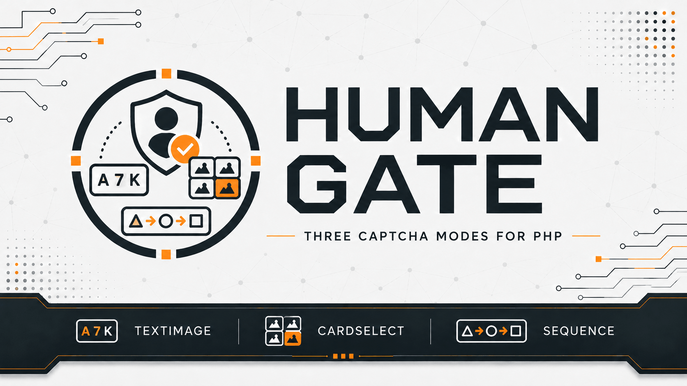

# Human Gate

[](https://github.com/yaleksandr89/human-gate)
[](https://github.com/yaleksandr89/human-gate/actions/workflows/ci.yml)
[](https://packagist.org/packages/yaleksandr89/human-gate)
[](https://packagist.org/packages/yaleksandr89/human-gate)
[](https://www.php.net/)
[](../../LICENSE)



## Choisir une langue

| Русский | English | Español | 中文 | Français | Deutsch |
|---|---|---|---|---|---|
| [Русский](../../README.md) | [English](README_en.md) | [Español](README_es.md) | [中文](README_zh.md) | **Sélectionné** | [Deutsch](README_de.md) |

Paquet Composer permettant de créer des CAPTCHA et de vérifier les réponses dans les applications PHP. Il convient aux formulaires d’inscription, de contact et de commentaires pour limiter les envois automatisés.

Les CAPTCHA sont créés et vérifiés sur le serveur, sans service externe. Le paquet fonctionne avec tout framework PHP ou sans framework.

## À quoi sert ce paquet

Avant de traiter un formulaire, l’application affiche un CAPTCHA. L’utilisateur soumet sa réponse, Human Gate la vérifie côté serveur, puis l’application poursuit si la réponse est correcte. Un CAPTCHA réussi ne peut pas être réutilisé.

## Fonctionnalités

- Trois types de CAPTCHA :
  - [**CAPTCHA textuel (`TextImage`)**](../challenges/text-image_fr.md): saisir les caractères affichés sur une image.
  - [**Sélection de cartes par catégorie (`CategorySelection`)**](../challenges/category-selection_fr.md): sélectionner les cartes d’une catégorie.
  - [**Séquence d’icônes (`IconSequence`)**](../challenges/icon-sequence_fr.md): reproduire l’ordre des icônes d’une image.
- Durée de validité, nombre de réponses incorrectes et nombre de CAPTCHA actifs configurables.
- Renouvellement du CAPTCHA et protection contre la réutilisation d’une bonne réponse.
- [Stockage fondé sur les sessions PHP standard](../guides/integration_fr.md) prêt à l’emploi.
- Développé en PHP, sans dépendance Composer tierce à l’exécution ni service externe de vérification. L’application choisit librement l’apparence et la mise en œuvre de l’interface.

## Prérequis

- `PHP ^8.4`.
- Extension `ext-gd` avec prise en charge de FreeType.
- Composer.

## Installation

```bash
composer require yaleksandr89/human-gate
```

## Démarrage rapide

Les trois exemples suivants créent un CAPTCHA avec une session PHP. Chacun ouvre la session avec `session_start()` et y conserve les données de vérification. Un autre mode de stockage peut être fourni via `ChallengeStore`, comme indiqué dans le [guide d’intégration](../guides/integration_fr.md).

Les captures de [alexanderyurchenko.ru](https://alexanderyurchenko.ru/) illustrent une présentation possible. Le paquet crée et vérifie les CAPTCHA ; l’application réalise l’interface.

### CAPTCHA textuel (`TextImage`)

L’utilisateur saisit six caractères d’une image. Par défaut, la casse n’est pas prise en compte.

<details>
<summary>Afficher l’exemple PHP du CAPTCHA textuel</summary>

```php
<?php

declare(strict_types=1);

use Yaleksandr\HumanGate\Challenge\Policy;
use Yaleksandr\HumanGate\Challenge\Purpose;
use Yaleksandr\HumanGate\ChallengeService;
use Yaleksandr\HumanGate\Clock\SystemClock;
use Yaleksandr\HumanGate\Session\ActiveNativeSessionScope;
use Yaleksandr\HumanGate\Session\NativeSessionChallengeStore;
use Yaleksandr\HumanGate\TextImage\GdTextImageRenderer;
use Yaleksandr\HumanGate\TextImage\TextImageStrategy;

require 'vendor/autoload.php';

if (!session_start()) {
    throw new RuntimeException('Не удалось открыть сессию PHP.');
}

$service = new ChallengeService(
    new NativeSessionChallengeStore(ActiveNativeSessionScope::capture()),
    new Policy(),
    new SystemClock(),
    new TextImageStrategy(new GdTextImageRenderer()),
);

$result = $service->issue(new Purpose('contact.send'));
if ($result->challenge === null) {
    throw new RuntimeException('Не удалось создать капчу.');
}

$id = $result->challenge->id->value();
$presentation = $result->challenge->presentation;
```

</details>

#### Exemple de CAPTCHA textuel sur le site


<details>
<summary>Autres vues : thème sombre et écrans mobiles</summary>

Thème sombre sur ordinateur :


Thème clair sur mobile :


Thème sombre sur mobile :


</details>

Vous pouvez régler la sensibilité à la casse, l’échelle de l’image, le flou, le bruit et la rotation. La réponse comporte toujours six caractères. Voir les [options du CAPTCHA textuel](../challenges/text-image_fr.md).

### Sélection de cartes par catégorie (`CategorySelection`)

L’utilisateur sélectionne toutes les cartes de la catégorie demandée. L’application fournit les catégories et les libellés ; l’ordre de sélection ne compte pas.

<details>
<summary>Afficher l’exemple PHP de sélection de cartes</summary>

```php
<?php

declare(strict_types=1);

use Yaleksandr\HumanGate\CategorySelection\CategorySelectionCategory;
use Yaleksandr\HumanGate\CategorySelection\CategorySelectionStrategy;
use Yaleksandr\HumanGate\Challenge\ChallengeKind;
use Yaleksandr\HumanGate\Challenge\Policy;
use Yaleksandr\HumanGate\Challenge\Purpose;
use Yaleksandr\HumanGate\ChallengeService;
use Yaleksandr\HumanGate\Clock\SystemClock;
use Yaleksandr\HumanGate\Session\ActiveNativeSessionScope;
use Yaleksandr\HumanGate\Session\NativeSessionChallengeStore;

require 'vendor/autoload.php';

if (!session_start()) {
    throw new RuntimeException('Не удалось открыть сессию PHP.');
}

$service = new ChallengeService(
    new NativeSessionChallengeStore(ActiveNativeSessionScope::capture()),
    new Policy(),
    new SystemClock(),
    new CategorySelectionStrategy([
        new CategorySelectionCategory('Фрукты', ['Яблоко', 'Груша', 'Слива', 'Персик']),
        new CategorySelectionCategory('Инструменты', ['Молоток', 'Пила', 'Отвёртка', 'Клещи']),
    ]),
);

$result = $service->issue(new Purpose('contact.send'), ChallengeKind::CategorySelection);
if ($result->challenge === null) {
    throw new RuntimeException('Не удалось создать капчу.');
}

$id = $result->challenge->id->value();
$presentation = $result->challenge->presentation;
```

</details>

#### Exemple de sélection de cartes sur le site


<details>
<summary>Autres vues : thème sombre et écrans mobiles</summary>

Thème sombre sur ordinateur :


Thème clair sur mobile :


Thème sombre sur mobile :


</details>

Vous pouvez régler le nombre de cartes et de réponses attendues ; l’application fournit les catégories. Voir les [options de sélection](../challenges/category-selection_fr.md).

### Séquence d’icônes (`IconSequence`)

L’utilisateur sélectionne les icônes dans l’ordre affiché sur l’image. L’ordre est important.

<details>
<summary>Afficher l’exemple PHP de séquence d’icônes</summary>

```php
<?php

declare(strict_types=1);

use Yaleksandr\HumanGate\Challenge\ChallengeKind;
use Yaleksandr\HumanGate\Challenge\Policy;
use Yaleksandr\HumanGate\Challenge\Purpose;
use Yaleksandr\HumanGate\ChallengeService;
use Yaleksandr\HumanGate\Clock\SystemClock;
use Yaleksandr\HumanGate\IconSequence\IconSequenceStrategy;
use Yaleksandr\HumanGate\Session\ActiveNativeSessionScope;
use Yaleksandr\HumanGate\Session\NativeSessionChallengeStore;

require 'vendor/autoload.php';

if (!session_start()) {
    throw new RuntimeException('Не удалось открыть сессию PHP.');
}

$service = new ChallengeService(
    new NativeSessionChallengeStore(ActiveNativeSessionScope::capture()),
    new Policy(),
    new SystemClock(),
    new IconSequenceStrategy(),
);

$result = $service->issue(new Purpose('contact.send'), ChallengeKind::IconSequence);
if ($result->challenge === null) {
    throw new RuntimeException('Не удалось создать капчу.');
}

$id = $result->challenge->id->value();
$presentation = $result->challenge->presentation;
```

</details>

#### Exemple de séquence d’icônes sur le site


<details>
<summary>Autres vues : thème sombre et écrans mobiles</summary>

Thème sombre sur ordinateur :


Thème clair sur mobile :


Thème sombre sur mobile :


</details>

Vous pouvez régler la longueur de la séquence, le nombre de choix, la taille des icônes, le flou, le bruit et la rotation. Voir les [options des séquences](../challenges/icon-sequence_fr.md).

Tous les CAPTCHA partagent les [réglages de validité et de tentatives](../reference/api_fr.md#policy). Par défaut, un CAPTCHA dure 180 secondes ; la valeur se modifie via `Policy::ttlSeconds`.

Ces exemples montrent comment créer un CAPTCHA. L’application utilise l’identifiant et les données d’image ou de cartes reçus pour l’afficher dans son formulaire. L’envoi de la réponse, [`ChallengeService::verify()`](../reference/api_fr.md#verify) et le renouvellement sont expliqués dans le [guide d’intégration](../guides/integration_fr.md).

## Cycle de vie du CAPTCHA

Par défaut, un CAPTCHA reste valable trois minutes. La limite des mauvaises réponses est distincte : la troisième erreur met fin à la vérification même s’il reste du temps. Une bonne réponse n’est acceptée qu’une fois. Voir la [validité, les tentatives et le renouvellement](../reference/lifecycle_fr.md).

## Vérification côté serveur

Human Gate conserve les données de vérification sur le serveur et ne transmet jamais la bonne réponse au navigateur. Chaque CAPTCHA est lié à un formulaire ou une opération par la clé [`Purpose`](../reference/api_fr.md#types-principaux) : un CAPTCHA de contact ne peut pas servir à une inscription. Voir la [vérification et le stockage](../security-model_fr.md).

## Retour et signalements

- Bugs reproductibles — [GitHub Issues](https://github.com/yaleksandr89/human-gate/issues).

---

<p align="center">
  Si ce paquet vous a été utile, attribuez-lui une étoile sur GitHub afin que d’autres développeurs le découvrent plus facilement. 🤘
</p>
