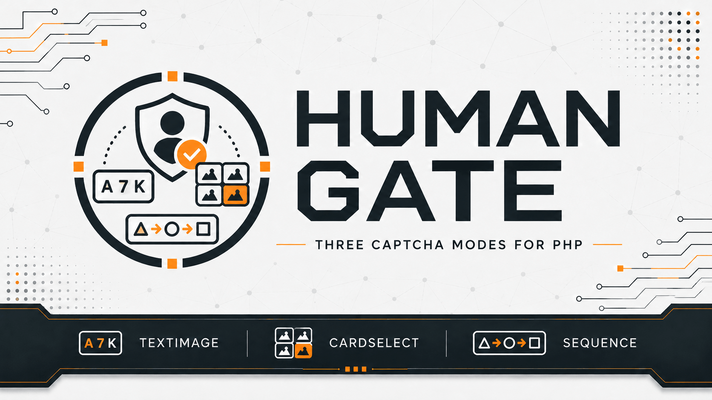

# Human Gate

[](https://github.com/yaleksandr89/human-gate)
[](https://github.com/yaleksandr89/human-gate/actions/workflows/ci.yml)
[](https://packagist.org/packages/yaleksandr89/human-gate)
[](https://packagist.org/packages/yaleksandr89/human-gate)
[](https://www.php.net/)
[](../../LICENSE)



## 选择语言

| Русский | English | Español | 中文 | Français | Deutsch |
|---|---|---|---|---|---|
| [Русский](../../README.md) | [English](README_en.md) | [Español](README_es.md) | **当前语言** | [Français](README_fr.md) | [Deutsch](README_de.md) |

一个用于在 PHP 应用中生成验证码并校验答案的 Composer 包。适用于注册、联系表单和评论提交等需要减少自动提交的场景。

验证码在服务器上生成和校验，无需调用外部服务。可以在任何 PHP 框架中使用，也可以不依赖框架。

## 用途

应用处理表单前显示验证码。用户提交答案后，Human Gate 在服务器端进行校验；答案正确时，应用即可继续处理。已通过的验证码不能重复使用。

## 功能

- 三种验证码：
  - [**文字验证码（`TextImage`）**](../challenges/text-image_zh.md): 输入图片中的字符。
  - [**分类卡片选择（`CategorySelection`）**](../challenges/category-selection_zh.md): 选择属于指定类别的卡片。
  - [**图标顺序验证码（`IconSequence`）**](../challenges/icon-sequence_zh.md): 按图片中的顺序选择图标。
- 可配置有效期、错误次数上限和同时有效的验证码数量。
- 支持刷新验证码，并防止正确答案被重复使用。
- 提供可直接使用的[标准 PHP 会话存储](../guides/integration_zh.md)。
- 使用 PHP 实现，运行时无需额外的 Composer 库或外部验证码服务。界面的外观和实现由应用自行决定。

## 运行要求

- `PHP ^8.4`。
- 支持 FreeType 的 `ext-gd` 扩展。
- Composer.

## 安装

```bash
composer require yaleksandr89/human-gate
```

## 快速开始

以下三个示例使用 PHP 会话创建验证码。每个示例通过 `session_start()` 开启会话，并将验证数据保存在会话中。也可以实现 `ChallengeStore` 使用其他存储方式，参见[集成指南](../guides/integration_zh.md)。

来自 [alexanderyurchenko.ru](https://alexanderyurchenko.ru/) 的截图展示了一种界面样式。包负责生成验证码并校验答案，前端界面由应用实现。

### 文字验证码（`TextImage`）

用户输入图片中的六个字符。默认不区分字母大小写。

<details>
<summary>查看文字验证码的 PHP 示例</summary>

```php
<?php

declare(strict_types=1);

use Yaleksandr\HumanGate\Challenge\Policy;
use Yaleksandr\HumanGate\Challenge\Purpose;
use Yaleksandr\HumanGate\ChallengeService;
use Yaleksandr\HumanGate\Clock\SystemClock;
use Yaleksandr\HumanGate\Session\ActiveNativeSessionScope;
use Yaleksandr\HumanGate\Session\NativeSessionChallengeStore;
use Yaleksandr\HumanGate\TextImage\GdTextImageRenderer;
use Yaleksandr\HumanGate\TextImage\TextImageStrategy;

require 'vendor/autoload.php';

if (!session_start()) {
    throw new RuntimeException('Не удалось открыть сессию PHP.');
}

$service = new ChallengeService(
    new NativeSessionChallengeStore(ActiveNativeSessionScope::capture()),
    new Policy(),
    new SystemClock(),
    new TextImageStrategy(new GdTextImageRenderer()),
);

$result = $service->issue(new Purpose('contact.send'));
if ($result->challenge === null) {
    throw new RuntimeException('Не удалось создать капчу.');
}

$id = $result->challenge->id->value();
$presentation = $result->challenge->presentation;
```

</details>

#### 网站上的文字验证码示例


<details>
<summary>其他样式：深色主题和移动端</summary>

桌面端深色主题：


移动端浅色主题：


移动端深色主题：


</details>

可配置大小写敏感性、图片缩放、模糊、噪点和字符旋转。答案长度始终为六个字符。参见[文字验证码设置](../challenges/text-image_zh.md)。

### 分类卡片选择（`CategorySelection`）

用户选择属于指定类别的所有卡片。类别与标签由应用提供，选择顺序不重要。

<details>
<summary>查看分类卡片的 PHP 示例</summary>

```php
<?php

declare(strict_types=1);

use Yaleksandr\HumanGate\CategorySelection\CategorySelectionCategory;
use Yaleksandr\HumanGate\CategorySelection\CategorySelectionStrategy;
use Yaleksandr\HumanGate\Challenge\ChallengeKind;
use Yaleksandr\HumanGate\Challenge\Policy;
use Yaleksandr\HumanGate\Challenge\Purpose;
use Yaleksandr\HumanGate\ChallengeService;
use Yaleksandr\HumanGate\Clock\SystemClock;
use Yaleksandr\HumanGate\Session\ActiveNativeSessionScope;
use Yaleksandr\HumanGate\Session\NativeSessionChallengeStore;

require 'vendor/autoload.php';

if (!session_start()) {
    throw new RuntimeException('Не удалось открыть сессию PHP.');
}

$service = new ChallengeService(
    new NativeSessionChallengeStore(ActiveNativeSessionScope::capture()),
    new Policy(),
    new SystemClock(),
    new CategorySelectionStrategy([
        new CategorySelectionCategory('Фрукты', ['Яблоко', 'Груша', 'Слива', 'Персик']),
        new CategorySelectionCategory('Инструменты', ['Молоток', 'Пила', 'Отвёртка', 'Клещи']),
    ]),
);

$result = $service->issue(new Purpose('contact.send'), ChallengeKind::CategorySelection);
if ($result->challenge === null) {
    throw new RuntimeException('Не удалось создать капчу.');
}

$id = $result->challenge->id->value();
$presentation = $result->challenge->presentation;
```

</details>

#### 网站上的分类卡片验证码示例


<details>
<summary>其他样式：深色主题和移动端</summary>

桌面端深色主题：


移动端浅色主题：


移动端深色主题：


</details>

可配置卡片数量和正确选项数量；应用提供类别目录。参见[分类选择设置](../challenges/category-selection_zh.md)。

### 图标顺序验证码（`IconSequence`）

用户按照图片中的顺序选择图标。顺序非常重要。

<details>
<summary>查看图标顺序验证码的 PHP 示例</summary>

```php
<?php

declare(strict_types=1);

use Yaleksandr\HumanGate\Challenge\ChallengeKind;
use Yaleksandr\HumanGate\Challenge\Policy;
use Yaleksandr\HumanGate\Challenge\Purpose;
use Yaleksandr\HumanGate\ChallengeService;
use Yaleksandr\HumanGate\Clock\SystemClock;
use Yaleksandr\HumanGate\IconSequence\IconSequenceStrategy;
use Yaleksandr\HumanGate\Session\ActiveNativeSessionScope;
use Yaleksandr\HumanGate\Session\NativeSessionChallengeStore;

require 'vendor/autoload.php';

if (!session_start()) {
    throw new RuntimeException('Не удалось открыть сессию PHP.');
}

$service = new ChallengeService(
    new NativeSessionChallengeStore(ActiveNativeSessionScope::capture()),
    new Policy(),
    new SystemClock(),
    new IconSequenceStrategy(),
);

$result = $service->issue(new Purpose('contact.send'), ChallengeKind::IconSequence);
if ($result->challenge === null) {
    throw new RuntimeException('Не удалось создать капчу.');
}

$id = $result->challenge->id->value();
$presentation = $result->challenge->presentation;
```

</details>

#### 网站上的图标顺序验证码示例


<details>
<summary>其他样式：深色主题和移动端</summary>

桌面端深色主题：


移动端浅色主题：


移动端深色主题：


</details>

可配置序列长度、可选图标数量、图标尺寸、模糊、噪点和旋转。参见[图标序列设置](../challenges/icon-sequence_zh.md)。

所有验证码共用[有效期和错误次数设置](../reference/api_zh.md#policy)。默认有效期为 180 秒，可通过 `Policy::ttlSeconds` 调整。

以上示例仅展示验证码的创建。应用使用返回的标识符以及图片或卡片数据来显示表单。发送答案、调用 [`ChallengeService::verify()`](../reference/api_zh.md#verify) 和刷新验证码的方法详见[集成指南](../guides/integration_zh.md)。

## 验证码生命周期

默认有效期为三分钟。错误次数上限独立计算：即使尚未超时，第三次错误也会结束验证。正确答案只能被接受一次。参见[有效期、尝试次数和刷新说明](../reference/lifecycle_zh.md)。

## 服务器端校验

Human Gate 将验证数据保留在服务器上，不会向浏览器发送正确答案。每个验证码都通过 [`Purpose`](../reference/api_zh.md#主要类型) 键与特定表单或操作绑定，例如发送消息的验证码不能用于注册。参见[校验与存储说明](../security-model_zh.md)。

## 反馈

- 可重现的错误 — [GitHub Issues](https://github.com/yaleksandr89/human-gate/issues).

---

<p align="center">
  如果这个包对你有帮助，欢迎在 GitHub 上点亮 Star，让更多开发者找到它。🤘
</p>
